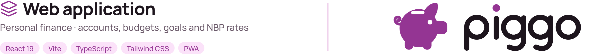
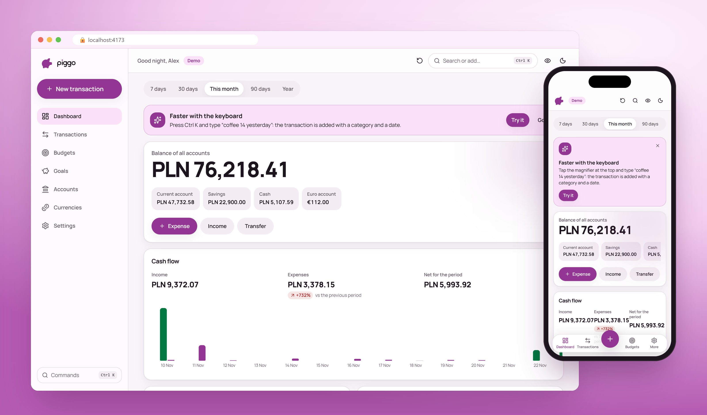
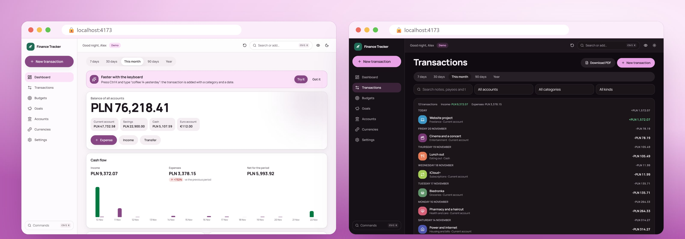
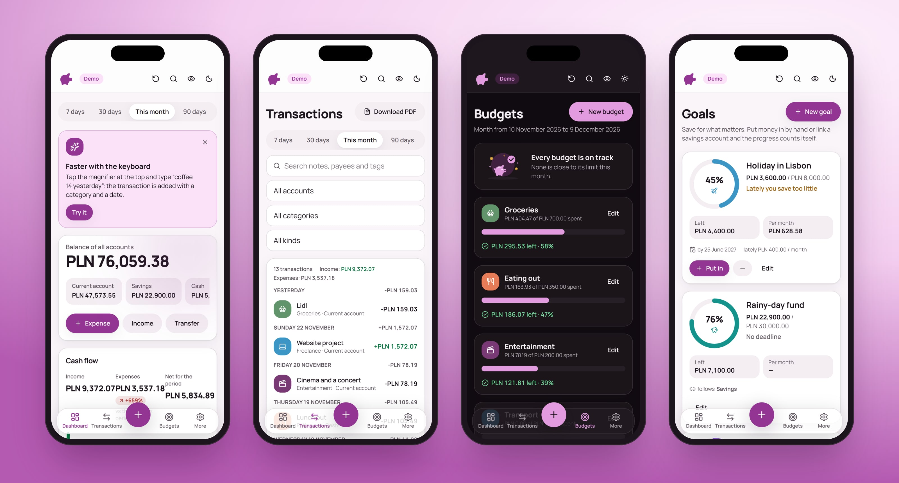

<p align="center">
  <picture>
    <source media="(prefers-color-scheme: dark)" srcset="docs/images/banner-dark.png">
    
  </picture>
</p>

<p align="center">
  
</p>

## About

**finance-tracker** (brand **Piggo**) is version 2 of a personal finance app: accounts in any currency, transactions, budgets and the
exchange rates of the National Bank of Poland in one calm, fast web app for the phone and the computer. It is the
successor of the team project [`personal-finance-manager`](https://github.com/DamTchorzewski/personal-finance-manager),
from which this repository was copied with its history and then rebuilt from scratch; its API is
[`finance-tracker-api`](https://github.com/DamTchorzewski/finance-tracker-api).

- **Accounts and balances.** Cash, bank, savings, card and foreign-currency accounts; the total in the main currency at
  today's NBP rates; archive instead of delete.
- **Transactions.** Expenses, income and transfers (also between currencies) in one form that opens from anywhere:
  amount first, categories as tiles, today and yesterday one tap away, undo after a delete. A list grouped by day with
  the day's total, filters and search kept in the address, virtualised for long lists.
- **Multi-currency.** Each transaction keeps its value in PLN at the NBP rate of its day (the API freezes it), so old
  reports do not change; reports in another main currency convert at today's rate.
- **Budgets.** A monthly limit per category, a month that starts on the pay day, progress that says "left" or "over"
  in words, not only in colour.
- **Currencies.** NBP table A and C, a converter, the history of any currency (30 days to a year), favourites; the ECB
  rates when NBP does not answer, and the app says so.
- **Dashboard.** Balance that counts up to its value, cash flow against the previous period, spending by category,
  budgets, recent transactions and rates; the widgets can be reordered and hidden.
- **Command palette (Ctrl K).** Go anywhere, run any action, or add a transaction in plain words:
  `kawa 14 zł wczoraj`, `+5200 pensja`, `Biedronka 86,40 18.11` (a local parser, no AI service).
- **Personal.** Polish and English, light, dark or system theme, an accent colour from one hue, privacy mode that blurs
  every amount, a greeting by the time of day and name.
- **CSV.** Export of a year of transactions (Excel opens it as is) and import of a bank export with column matching and
  duplicate detection.
- **Demo without an account.** Twelve months of believable data kept only in the browser; every feature works, a reset
  button restores it.
- **Installable and offline.** A PWA with the last data kept in IndexedDB; a new version asks before it reloads.
- **Built to the standards.** WCAG 2.2 AA in both themes (axe in the e2e tests), security headers and CSP on Firebase
  Hosting, heavy code (charts, Firebase) loaded on demand.

> **Status:** release 1 in progress (2026-11-21): the app runs end to end in the demo; the sign-in and the live site
> wait for the Google setup in [docs/deployment.md](docs/deployment.md). The plan is [docs/redesign-plan.md](docs/redesign-plan.md).
> The app carries the Piggo brand ([docs/brand.md](docs/brand.md)). There is no live site yet, so no "Open site"
> button.

## Tech stack

|          |                                                                                                               |
| -------- | ------------------------------------------------------------------------------------------------------------- |
| Stack    | Vite 8, React 19, TypeScript (strict), TanStack Router and Query (persisted to IndexedDB)                     |
| UI       | Tailwind CSS 4 with OKLCH design tokens, Radix primitives, cmdk, Sonner, Lucide, Manrope (self-hosted)        |
| Charts   | Recharts 3, loaded on demand, with the same numbers as text next to each chart                                |
| Data     | `finance-tracker-api` (types generated from its `openapi.json`), or the demo in localStorage                  |
| Auth     | Firebase Authentication (e-mail and password, Google), loaded only when it is needed                          |
| Services | NBP and ECB rates through the API                                                                             |
| Tests    | Vitest (money, dates, statistics, CSV, quick add), Playwright + axe-core (desktop and mobile, light and dark) |
| Hosting  | Firebase Hosting, `/api/**` rewritten to Cloud Run; PWA (Workbox)                                             |

The interface is Polish and English; code, comments, commits and the README are English; `docs/` is Polish.

## Screenshots

<p align="center">
  
</p>

<p align="center">
  
</p>

The screenshots are the built-in demo (sample data only, no account).

## Quick start

```bash
git clone https://github.com/DamTchorzewski/finance-tracker.git
cd finance-tracker
pnpm install
pnpm dev               # http://localhost:5173, "Try the demo" works without anything else
```

For the sign-in, copy `.env.example` to `.env.local` and fill in the Firebase web app settings; for live rates and data
run `finance-tracker-api` on port 8080 (`pnpm dev` proxies `/api` to it).

Requirements: Node.js 22.18 or newer (`.nvmrc`: 22) and pnpm 11.18 (`packageManager`).

## Scripts

| Command                        | Does                                                                      |
| ------------------------------ | ------------------------------------------------------------------------- |
| `pnpm dev`                     | the app with hot reload                                                   |
| `pnpm build`                   | typecheck and production build to `dist/` (with the service worker)       |
| `pnpm preview`                 | serves `dist/` on port 4173                                               |
| `pnpm check`                   | `format:check`, `lint`, `typecheck` and `test`: run before a pull request |
| `pnpm test`                    | unit tests (Vitest)                                                       |
| `pnpm test:e2e`                | Playwright: every page in the demo, the main flows, axe in both themes    |
| `pnpm api:types`               | regenerates `src/api/schema.d.ts` from `src/api/openapi.json`             |
| `pnpm health`                  | read-only check of the live app (`SITE_URL`)                              |
| `pnpm format`, `pnpm lint:fix` | fix formatting and lint                                                   |

## Configuration

All variables, names only, are in [`.env.example`](.env.example). None is a secret: they are the public settings of the
Firebase web app, baked into the build. Without them the app builds and the demo works; the sign-in says it is off.

The API contract is `src/api/openapi.json`, a copy of `openapi.json` from `finance-tracker-api`; after an API change copy
it again and run `pnpm api:types`, and `pnpm typecheck` shows every place the change touches.

## Structure

```
src/
  main.tsx               providers: language, query cache (IndexedDB), session, router, PWA update
  app/                   router, shell (side rail, dock, top bar), the global transaction form, look and language
  auth/                  Firebase sign-in (loaded on demand) and the session: nobody, demo or a user
  data/                ★ the data source interface, the API source, the demo source and its sample data, queries
  features/            ★ one folder per screen: dashboard, transactions, accounts, budgets, currencies, settings
  components/ui/         button, card, field, sheet, amount
  i18n/                ★ messages.ts: every text in Polish and English
  lib/                   money, dates and pay months, statistics, CSV, quick add (with tests)
  styles/app.css       ★ design tokens (OKLCH, accent hue), themes, utilities
public/                  theme.js (no flash of the wrong theme), icon, manifest
tests/e2e/               smoke, flows and accessibility tests
scripts/health-check.ts  the live check after a deploy and every Monday
firebase.json            Hosting: headers, CSP, caching, /api rewrite
```

## Branches and workflows

Shared standards from `reops/standards`: `main` ≤ `develop` ≤ a working branch `<type>/<topic>`, Conventional Commits in
English (`git.md`). `ci.yml` checks every pull request (quality, then e2e); `deploy.yml` runs CI and a build on
`develop` and `main` and deploys `main` to Firebase Hosting with a health check; `weekly.yml` checks the live app every
Monday (`workflows.md`, level 3).

**Departures from the standards (and why):**

- **Copied history of a team project:** the repository keeps the history of `personal-finance-manager` (team work) and
  its MIT notice, with the version 2 author added; see [docs/decisions.md](docs/decisions.md).
- **No "Open site" button:** the app is not deployed yet (it waits for the Google setup); the frames show the local
  preview address.

## Documentation

| File                                           | What it covers                                                       |
| ---------------------------------------------- | -------------------------------------------------------------------- |
| [docs/redesign-plan.md](docs/redesign-plan.md) | version 2: stack, features, design, data model, releases, decisions  |
| [docs/decisions.md](docs/decisions.md)         | technical decisions with the reason and the date                     |
| [docs/deployment.md](docs/deployment.md)       | Firebase Hosting, the Google setup, GitHub variables, rollback       |
| [docs/repository.md](docs/repository.md)       | GitHub description and topics, and the command that sets them        |
| [docs/brand.md](docs/brand.md)                 | the Piggo name, logo, colours, type, illustrations, motion and icons |

The README images (`docs/images/`) are made with `tools/readme-images`, profile `finance-tracker`, from the demo in a
local `pnpm preview`; the working shots go to `.scratch/`.

## Versions

| Version                    | Repository                                                                               | Made by                                                                                                            |
| -------------------------- | ---------------------------------------------------------------------------------------- | ------------------------------------------------------------------------------------------------------------------ |
| 1                          | [`personal-finance-manager`](https://github.com/DamTchorzewski/personal-finance-manager) | the S7ven Survivors team (see its [Team section](https://github.com/DamTchorzewski/personal-finance-manager#team)) |
| 2: Piggo (this repository) | `finance-tracker`                                                                        | [Damian Tchorzewski](https://github.com/DamTchorzewski)                                                            |

Licensed under the [MIT License](LICENSE).

---

<p align="center"><a href="https://damreboot.pl"><picture><source media="(prefers-color-scheme: dark)" srcset="docs/images/damreboot/company-dark.svg"></picture></a><a href="https://www.linkedin.com/in/damian-tchorzewski-3b2388275/"><picture><source media="(prefers-color-scheme: dark)" srcset="docs/images/damreboot/linkedin-dark.svg"></picture></a><a href="mailto:damianchabracki@gmail.com"><picture><source media="(prefers-color-scheme: dark)" srcset="docs/images/damreboot/email-dark.svg"></picture></a></p>

<p align="center">
  <picture><source media="(prefers-color-scheme: dark)" srcset="docs/images/damreboot/engineered-dark.svg"></picture> Engineered by <b>Damian Chabracki</b> (DamReboot IT)
</p>
